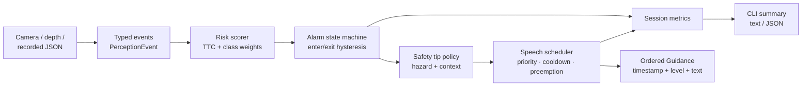
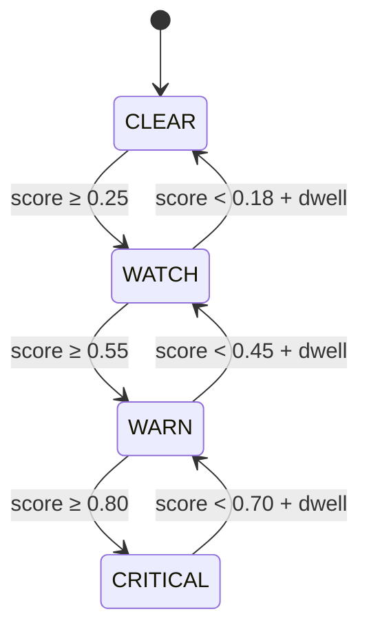

# MGIA — Real-Time Hands-Free Safety Guidance

> A safety alert that arrives late is noise. MGIA turns noisy perception frames
> into **short, ordered, interruptible guidance** — with risk scoring, alarm
> hysteresis, and accessible speech scheduling that run on the standard library
> alone.

[](https://www.python.org/)
[](#measured-results)
[](#measured-results)
[](LICENSE)
[](https://github.com/MrKyaw/Mobility-Guided-Intelligent-Assistant-MGIA-for-Real-Time-Handsfree-Safety-Tips/actions/workflows/ci.yml)

## The problem

Assistive perception is only useful if the guidance is **timely, stable, and
possible to follow**. A detector that fires every frame produces alert storms;
a system that speaks every detection buries the one warning that matters. The
hard engineering is not drawing a bounding box — it is deciding what deserves
the user's attention, when to escalate, when to stay quiet, and how to avoid
repeating the same sentence while a hazard persists.

MGIA is a deterministic real-time core for that decision layer. It consumes
typed perception events, computes a time-to-contact risk score, applies an
alarm state machine with hysteresis and dwell time, selects hazard-aware safety
tips, and schedules speech with priority, cooldowns, and preemption. It is
offline, dependency-free, and testable without a camera, microphone, network,
or LLM.

The original notebook-era MGIA prototype (visual perception, multimodal prompts,
LLM integration) is preserved in `src/`, `config/`, `data/`, and `test/`.
`mgia_realtime/` is the new, independently runnable safety core.

## Real-time architecture



The alarm has four states. Upward transitions are immediate; downward
transitions require crossing a lower exit threshold **and** satisfying the
minimum dwell time, and move one level at a time.



Each frame produces at most one utterance start. Urgent guidance can preempt a
lower-priority sentence, while repeated guidance is merged or cooled down. All
timestamps come from the frame stream, so ordering and latency are reproducible.

## Repository map

```text
.
├── mgia_realtime/              # New dependency-free real-time safety core
│   ├── events.py               # Typed/validated perception events + JSON parser
│   ├── risk.py                 # TTC-style risk scoring, class/position weights
│   ├── alarm.py                # CLEAR/WATCH/WARN/CRITICAL hysteresis machine
│   ├── speech.py               # Priority queue, cooldown, preemption, profiles
│   ├── tips.py                 # Hazard/context tip templates, anti-repetition
│   ├── metrics.py              # Counters, latency percentiles, time-in-state
│   ├── pipeline.py             # Frame → risk → alarm → tip → guidance orchestrator
│   ├── demo.py                 # Deterministic 10-frame synthetic scenario
│   ├── cli.py, __main__.py     # python -m mgia_realtime
│   └── errors.py               # Custom exception hierarchy
├── tests/test_mgia_realtime.py # 110 tests, 100% line+branch coverage
├── examples/frames.json        # Replayable four-frame example
├── docs/
│   ├── DESIGN_DECISIONS.md     # Trade-offs and rejected alternatives
│   └── ACCESSIBILITY_AND_SAFETY.md
├── ARCHITECTURE.md
├── TESTING.md
├── CONTRIBUTING.md
├── Makefile
├── pyproject.toml              # Metadata, pytest config, coverage gate
├── .github/workflows/ci.yml    # Python 3.10–3.12 matrix
├── src/                        # Preserved original prototype modules/notebook
├── test/                       # Preserved legacy placeholders (not in default run)
├── config/, data/              # Preserved original configuration/data docs
├── Dockerfile, docker-compose.yml, main.tf
├── requirements.txt
└── LICENSE
```

## Quickstart

Requires Python 3.10+. No third-party runtime dependencies.

```bash
# From the repository root — no install required
python3 -m mgia_realtime --demo

# Structured output for dashboards or tests
python3 -m mgia_realtime --demo --json

# Replay a recorded frame file
python3 -m mgia_realtime --frames examples/frames.json --profile verbose

# Optional editable install (adds the `mgia-realtime` console script)
python3 -m pip install -e ".[dev]"
```

Example demo output (actual local run):

```text
[  2.00s] WATCH    Pedestrian detected on your left. Keep scanning. Keep to the clearer side of the path.
[  3.00s] WARN     Pedestrian on your left, 3 metres away. Slow down. Stay behind the kerb until the path is clear.
[  4.00s] CRITICAL Pedestrian in your path. Stop now. Stay behind the kerb until the path is clear.

10 frames | 3 guidance messages | p50 0.0 ms | p95 0.0 ms | dropped 0 | coalesced 0
```

The demo uses a **logical session clock**, not wall-clock time. A frame is
created and emitted at the same timestamp, so its end-to-end latency is 0 ms.
That number is an ordering check, not a hardware latency benchmark. See
[Accessibility & safety](docs/ACCESSIBILITY_AND_SAFETY.md) for measured-vs-real
limitations.

### Frame input format

```json
[
  {
    "timestamp_s": 2.0,
    "frame_id": 2,
    "context": "walking",
    "objects": [
      {
        "object_id": "ped-1",
        "class": "pedestrian",
        "confidence": 0.92,
        "distance_m": 2.4,
        "relative_speed_mps": 1.8,
        "position": "left"
      }
    ],
    "hazards": [
      {"kind": "pedestrian_path", "confidence": 0.9, "object_id": "ped-1"}
    ]
  }
]
```

The parser also accepts `{"frames": [...]}`. See the schema in
[ARCHITECTURE.md](ARCHITECTURE.md#frame-schema).

### Python API

```python
from mgia_realtime import PipelineConfig, RealtimePipeline, VerbosityProfile
from mgia_realtime.events import PerceptionEvent

pipeline = RealtimePipeline(PipelineConfig(profile=VerbosityProfile.VERBOSE))
for event in (PerceptionEvent.from_dict(frame) for frame in frames):
    for guidance in pipeline.process(event):
        print(guidance.timestamp_s, guidance.level.name, guidance.text)

print(pipeline.snapshot().to_dict())
```

## Measured results

Local run on Python 3.12.8, repository root, no network or external services:

```text
$ python3 -m pytest -q
110 passed

$ python3 -m pytest --cov=mgia_realtime --cov-branch --cov-report=term-missing
Name                        Stmts   Miss Branch BrPart   Cover
mgia_realtime/__init__.py      11      0      0      0 100.00%
mgia_realtime/__main__.py       2      0      0      0 100.00%
mgia_realtime/alarm.py         96      0     38      0 100.00%
mgia_realtime/cli.py           57      0      8      0 100.00%
mgia_realtime/demo.py           6      0      0      0 100.00%
mgia_realtime/errors.py         7      0      0      0 100.00%
mgia_realtime/events.py       168      0     64      0 100.00%
mgia_realtime/metrics.py       89      0     12      0 100.00%
mgia_realtime/pipeline.py      71      0     12      0 100.00%
mgia_realtime/risk.py         101      0     36      0 100.00%
mgia_realtime/speech.py       182      0     54      0 100.00%
mgia_realtime/tips.py          97      0     36      0 100.00%
TOTAL                         887      0    260      0 100.00%

Required test coverage of 100.0% reached. Total coverage: 100.00%
```

Coverage is enforced by `pyproject.toml` (`fail_under = 100`, branch mode,
source `mgia_realtime`). The CI matrix runs the same gate on Python 3.10, 3.11,
and 3.12. CI status is not claimed here until the workflow has run on GitHub.

The legacy `test/` directory is preserved but excluded from the default run:
its files are empty notebook-era placeholders and collect no tests. It is not
claimed to pass as a functioning suite. See [TESTING.md](TESTING.md).

## CLI reference

| Command | Purpose |
| --- | --- |
| `python3 -m mgia_realtime --demo` | Ten-frame synthetic walking scenario, human-readable |
| `python3 -m mgia_realtime --demo --json` | Same run with guidance and metrics as JSON |
| `python3 -m mgia_realtime --frames FILE` | Replay validated JSON frames |
| `--profile concise\|standard\|verbose` | Choose how much guidance is spoken |
| `--help` | Full option list |

Profiles change what reaches the speech channel:

- **concise** — HIGH/CRITICAL only; warnings and stop instructions, no scanning chatter.
- **standard** — WATCH and above, with context-aware cues.
- **verbose** — adds distance/contact detail and is useful during development.

Deduplication keys and cooldowns are independent of profiles, so switching
profiles does not cause duplicate urgent alerts.

## Engineering decisions

- **Standard library only in the runtime.** Reviewers can run the safety logic
  without installing OpenCV, PyTorch, or an LLM SDK. The original prototype
  remains available for the multimodal demo.
- **TTC over a learned risk model.** The score is auditable, deterministic, and
  degrades to a conservative value when depth is missing. It is explicitly a
  heuristic, not a certified collision predictor.
- **Hysteresis and dwell on the way down.** Escalation must never wait; de-escalation
  must not flap. Exit thresholds sit below enter thresholds, and downgrades step
  one level at a time.
- **One utterance per frame clock tick.** This makes ordering, deduplication, and
  latency accounting deterministic. Preemption is explicit rather than hidden in
  a thread race.
- **Injectable metrics.** The pipeline owns no global state, so tests can assert
  exact counts and percentiles. Percentiles use linear interpolation and return
  `None` for an empty sample set rather than a misleading zero.
- **100% branch coverage instead of snapshot tests.** Safety behavior is mostly
  boundary behavior: exact thresholds, missing distance, cooldown edges,
  preemption, empty queues. Those are tested directly.

More detail: [docs/DESIGN_DECISIONS.md](docs/DESIGN_DECISIONS.md).

## Accessibility and safety limitations

This is an engineering prototype, **not a medical device, navigational aid, or
substitute for a cane, guide dog, or human support**. Key limitations:

- No camera, microphone, TTS engine, or hardware integration is included in the
  tested core. Input is typed frames; output is text guidance.
- The demo evaluates a synthetic scenario only. There is no user study, field
  trial, or clinical validation.
- TTC assumes relative speed is provided by perception and is accurate. Real
  depth noise, occlusion, and latency are not modelled.
- The rule-based phrasings are English-only and not localized or culturally
  validated. Concise mode can suppress WATCH-level context by design.
- Percentiles from the demo use a logical clock; no hardware latency budget is
  claimed. Real deployments need end-to-end measurement on the target device.
- False negatives remain possible. The system must fail safe and must never be
  the only source of hazard information.

Read the full discussion: [docs/ACCESSIBILITY_AND_SAFETY.md](docs/ACCESSIBILITY_AND_SAFETY.md).

## Recruiter snapshot

**What this repository demonstrates:** real-time systems design, safety-critical
state machines, streaming/backpressure thinking, accessibility product judgment,
dependency-free Python packaging, and rigorous branch-level testing.

**Thirty-second tour:**

1. Run `python3 -m mgia_realtime --demo`.
2. Open `mgia_realtime/alarm.py` — hysteresis plus minimum dwell.
3. Open `mgia_realtime/speech.py` — priority, coalescing, cooldown, preemption.
4. Run the coverage command above — 100% line and branch for the new package.
5. Read `docs/DESIGN_DECISIONS.md` for the trade-offs and rejected alternatives.

**Author:** Kyaw Kyaw Oo — [kyaw.tech@gmail.com](mailto:kyaw.tech@gmail.com) ·
[github.com/MrKyaw](https://github.com/MrKyaw)

## License

MIT. See [LICENSE](LICENSE). The preserved prototype retains its original
authorship notes in `src/`.


⭐ Star this repo if you find it useful!

Report Bug · Request Feature · Ask Question
